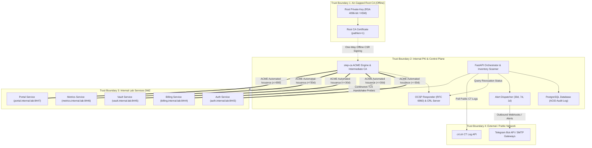
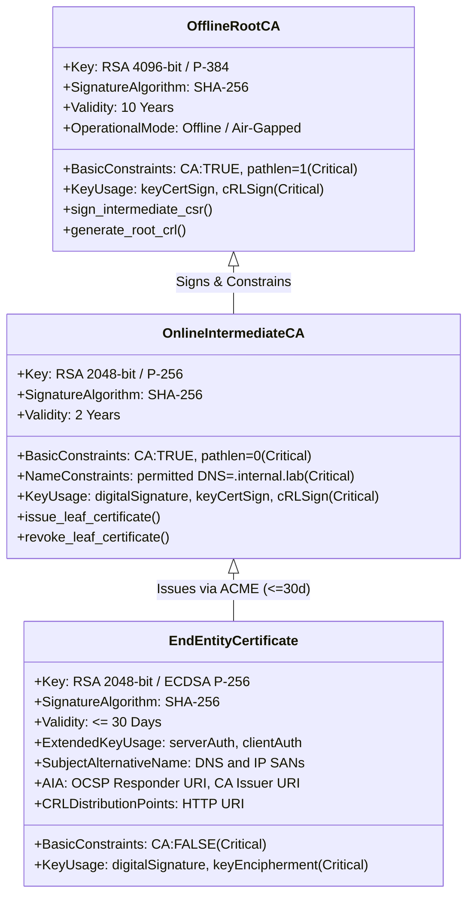
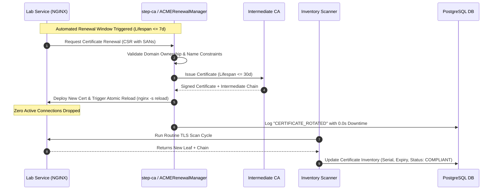
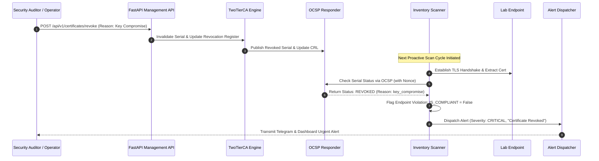
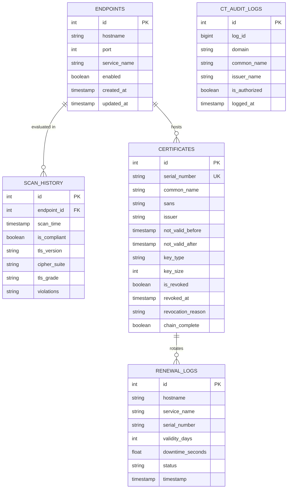
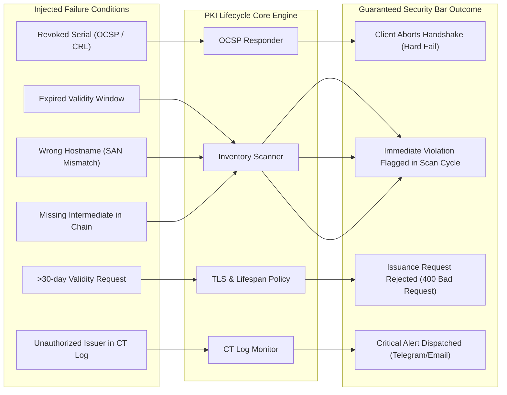
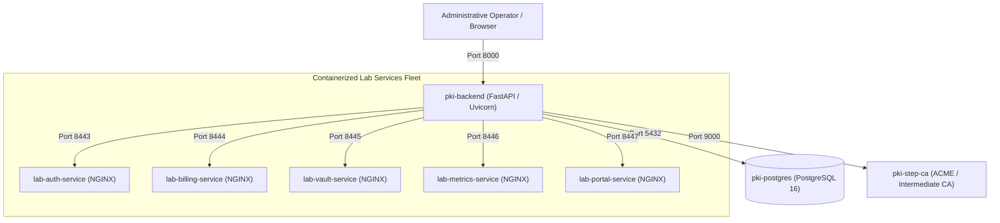

# System Architecture & Security Design Document: Private PKI & Certificate Lifecycle Manager

**Course:** CSSS 441 Software Security I  
**Project:** Project 7 — Private PKI and Certificate Lifecycle Manager  
**Group:** Group 7  
**Academic Term:** Level 400, 1st Semester  
**Target Milestone:** Week 4 Architecture & Threat Model (5%) & Week 10 Final Deliverable (25%)  

---

## 1. Executive Summary & Architectural Overview

The **Private PKI & Certificate Lifecycle Manager** is an enterprise-grade, automated public key infrastructure designed for high-security enterprise environments and lab networks. It eliminates traditional operational and cryptographic vulnerabilities—such as certificate expiration outages, rogue CA issuance, silent revocation failures, and legacy cryptographic suite downgrade attacks—by implementing strict cryptographic segregation, automated life-cycle management, real-time inventory discovery, and continuous security grading.

### Core Security Objectives & PDF Mandates
1. **Two-Tier Certificate Authority Hierarchy:** Strict separation between an air-gapped **Offline Root CA** and an online **Intermediate CA** enforcing X.509 path-length limits (`pathlen:0`) and domain Name Constraints (`.internal.lab`).
2. **Short-Lived Certificates & Automated ACME Renewal:** Strict enforcement of a maximum **30-day certificate lifespan** with automated zero-downtime rotation via ACME (`step-ca`, `certbot`/`lego`) across 5+ internal microservices.
3. **High-Assurance Revocation Architecture:** Real-time certificate status validation utilizing both RFC 5280 **Certificate Revocation Lists (CRL)** and RFC 6960 **Online Certificate Status Protocol (OCSP)** responders with nonces and short validity windows.
4. **Active TLS Inventory & Compliance Scanner:** Proactive continuous probing of internal TLS endpoints to detect expired certificates, Subject Alternative Name (SAN) mismatches, incomplete certificate chains, and revoked credentials within a **single scan cycle**.
5. **TLS Policy Grading Engine:** Automated grading and enforcement flagging any cipher suite below **TLS 1.2** or utilizing non-AEAD ciphers (e.g., CBC mode, 3DES, RC4).
6. **Certificate Transparency (CT) Auditing:** Continuous external log monitoring via the `crt.sh` API to instantly alert on rogue or unauthorized certificates issued for monitored domains.
7. **Tamper-Evident Multi-Tier Alert Dispatching:** Automated notification triggers (Email/Telegram) at 30-day, 7-day, and 1-day thresholds prior to expiration.

---

## 2. High-Level System Architecture & Trust Boundaries

The system is compartmentalized into four distinct physical and logical trust boundaries to prevent lateral compromise and key exfiltration:



### Trust Boundary Analysis
* **Boundary 1 (Air-Gapped Offline Root):** Completely isolated from network communication. The Root private key never touches network interfaces or container bridges.
* **Boundary 2 (Internal Management Plane):** Accessible only via authenticated administrative channels. Hosts the online Intermediate CA, the inventory database, and core API dispatchers.
* **Boundary 3 (Lab Microservices DMZ):** Containerized NGINX services serving mutual/server TLS. Endpoints accept incoming application requests while their certificates are rotated automatically via local ACME agents.
* **Boundary 4 (Public Egress):** Unprivileged outbound egress strictly for querying public Certificate Transparency logs and dispatching alerting payloads.

---

## 3. Cryptographic Specification & Two-Tier CA Hierarchy

The cryptographic foundation strictly avoids homemade cryptography and is built exclusively using vetted industry standards (`cryptography` Hazmat layer, OpenSSL, and `smallstep/step-ca`).



### 3.1 Tier 1: Offline Root CA (Trust Anchor)
* **Private Key:** 4096-bit RSA with public exponent $e = 65537$ generated in an offline, air-gapped environment.
* **X.509 v3 Extensions:**
  * `basicConstraints = critical, CA:TRUE, pathlen:1` (Restricts the root to signing Intermediate CAs only; forbids 3rd-tier subordinate CAs).
  * `keyUsage = critical, keyCertSign, cRLSign`.
  * `subjectKeyIdentifier = hash`.
* **Key Ceremony:** Formal offline key ceremony documented in ceremony notes. Root key files are stored encrypted on read-only cold media with physical custody logs.

### 3.2 Tier 2: Online Intermediate CA
* **Private Key:** 2048-bit RSA / P-256 held by the `step-ca` daemon.
* **X.509 v3 Extensions:**
  * `basicConstraints = critical, CA:TRUE, pathlen:0` (Cryptographically guarantees that this CA cannot issue another subordinate CA; it can only sign end-entity certificates).
  * `nameConstraints = critical, permitted;DNS:.internal.lab` (Strictly forbids the Intermediate CA from signing certificates outside the `.internal.lab` namespace, protecting the global PKI ecosystem from accidental rogue issuance).
  * `keyUsage = critical, digitalSignature, keyCertSign, cRLSign`.
  * `authorityKeyIdentifier = keyid:always`.

### 3.3 End-Entity (Leaf) Certificates
* **Validity Period:** Capped at **$\le 30$ days** (default 14–30 days) to minimize the exposure window of compromised keys.
* **Extensions:**
  * `basicConstraints = critical, CA:FALSE`.
  * `keyUsage = critical, digitalSignature, keyEncipherment`.
  * `extendedKeyUsage = serverAuth, clientAuth`.
  * `subjectAltName = critical, DNS:auth.internal.lab, DNS:localhost, IP:127.0.0.1` (RFC 2818 deprecates Common Name matching; SANs are strictly required).
  * `authorityInfoAccess = OCSP;URI:http://pki-backend:8000/api/v1/ocsp`.

---

## 4. Module Decomposition & Core Subsystems

The application codebase is modularized under [`src/pki_lifecycle/`](file:///c:/Users/PC/OneDrive/Documents/DOCS/UNI%20files/LVL%20400/1st%20semester/CSSS%20441%20Software%20Security/projects/KPI%20and%20certificate%20lifecycle%20manager/src/pki_lifecycle) with clean separation of concerns:

```
src/pki_lifecycle/
├── acme/
│   ├── __init__.py
│   └── renewal.py           # Module 2: Automated Issuance & Zero-Downtime Rotation
├── alerts/
│   ├── __init__.py
│   └── dispatcher.py        # Module 5: Multi-Threshold Expiry & Incident Alerts
├── crypto/
│   ├── __init__.py
│   ├── authority.py         # Module 1: Two-Tier CA, Key Generation & CRL Builder
│   └── ocsp_responder.py    # Module 3: RFC 6960 OCSP Verification Engine
├── ct_monitor/
│   ├── __init__.py
│   └── monitor.py           # Module 6: crt.sh API Ingestion & Rogue Detection
├── database/
│   ├── __init__.py
│   └── repository.py        # Data Access: Parameterized Queries & Audit Store
├── grading/
│   ├── __init__.py
│   └── policy.py            # Module 7: TLS 1.2+ & AEAD Cipher Suite Policy Engine
├── inventory/
│   ├── __init__.py
│   ├── collector.py         # Module 4: Live TLS Probing & X.509 Chain Parser
│   └── scanner.py           # Module 4: Fleet-Wide Asynchronous Scanner
├── rendering/
│   ├── __init__.py
│   └── templates.py        # Secure Auto-Escaping Template Engine
├── validation/
│   ├── __init__.py
│   └── schemas.py          # Week 2: Pydantic Input Validation & Sanitization
├── config.py                # Environment Configuration & Hardened Defaults
└── main.py                  # FastAPI Application Entrypoint & Middleware
```

### 4.1 ACME Auto-Issuance & Zero-Downtime Renewal Engine (`acme/renewal.py`)
Responsible for managing short certificate lifespans:
* Maintains registry of the 5+ containerized NGINX services (`auth`, `billing`, `vault`, `metrics`, `portal`).
* Evaluates expiry status against a defined threshold (e.g., automatically re-issuing when remaining lifespan $\le 7$ days).
* Implements graceful zero-downtime key rotation: writes new private keys and certificates atomically, verifies new certificate viability, and signals web server reload (`nginx -s reload`) without terminating in-flight TLS handshakes.
* Records each rotation event with sub-millisecond precision into the audit trail.

### 4.2 Revocation Architecture: CRL & OCSP Responder (`crypto/ocsp_responder.py` & `crypto/authority.py`)
Enforces immediate invalidation of compromised credentials:
* **RFC 5280 CRL Distribution Point:** Exposes `/api/v1/crl` yielding DER/PEM formatted CRLs signed by the Intermediate CA with monotonically incrementing CRL numbers.
* **RFC 6960 OCSP Responder:** Exposes `/api/v1/ocsp` accepting both HTTP GET (URL-safe base64) and POST (binary DER) requests.
* **Replay Protection:** Evaluates request nonces and embeds matching nonces in cryptographically signed OCSP responses.
* **Caching & Freshness:** Sets `thisUpdate` to current timestamp and `nextUpdate` to $t + 1\text{ hour}$, preventing replay of stale "Good" tokens while allowing legitimate intermediary caching.

### 4.3 TLS Inventory Engine & Active Scanner (`inventory/scanner.py` & `collector.py`)
Continuous discovery and integrity validation:
* Probes all registered host:port combinations using Python's `ssl` context.
* Extracts the complete server certificate chain: Leaf, Intermediate, and Root.
* Performs 4-point real-time compliance evaluation:
  1. **Hostname Validation:** Matches connection FQDN against SAN DNS names.
  2. **Lifespan Validity:** Validates current time against `notBefore` and `notAfter`.
  3. **Chain Completeness:** Confirms intermediate certificates are supplied by the server rather than relying on cached client state (AIA chasing).
  4. **Revocation Check:** Interrogates OCSP/CRL to ensure serial has not been marked revoked.

### 4.4 TLS Policy & Grading Engine (`grading/policy.py`)
Assesses server configuration against enterprise standards:
* **Grade A+:** TLS 1.3 with modern AEAD cipher suites (e.g., `TLS_AES_256_GCM_SHA384`, `TLS_CHACHA20_POLY1305_SHA256`).
* **Grade A:** TLS 1.2 with AEAD ciphers (`ECDHE-RSA-AES128-GCM-SHA256`).
* **Grade B:** TLS 1.2 using CBC ciphers (flags warning for Lucky13/POODLE surface).
* **Grade F (Policy Violation):** Any support for TLS 1.0, TLS 1.1, SSLv3, or insecure ciphers (RC4, 3DES).
* Designed for direct integration with `testssl.sh` automated CLI scans.

### 4.5 Certificate Transparency Monitor (`ct_monitor/monitor.py`)
Guards against rogue external issuance:
* Periodically polls `https://crt.sh/?q=%.internal.lab&output=json`.
* Validates every logged certificate against a whitelist of authorized Issuing CAs (`Group 7 Online Intermediate CA`, `Group 7 Offline Root CA`).
* Flags rogue or unexpected certificates and immediately escalates a `CRITICAL` alert to the dispatcher.

### 4.6 Multi-Channel Alert Dispatcher (`alerts/dispatcher.py`)
Operational escalation:
* Triggers warnings at **30 days**, **7 days**, and **1 day** before expiration.
* Categorizes alerts by severity: `INFO`, `WARNING`, `CRITICAL`.
* Formats payloads for automated dispatch via Telegram Bot webhooks, SMTP alerts, and administrative dashboard banners.

---

## 5. End-to-End Operational Workflows

### 5.1 Automated ACME Certificate Issuance & Zero-Downtime Rotation


### 5.2 Failure Injection & Incident Detection Lifecycle


---

## 6. Threat Modeling & Security Controls Traceability (STRIDE)

In compliance with CSSS 441 Week 1 and Week 4 requirements, all architecture decisions map back directly to the STRIDE threat analysis:

| Threat ID | Threat Description | STRIDE Category | Impacted Component | Implemented Security Control | Verification Test Case |
|:---:|:---|:---:|:---|:---|:---|
| **T1** | Intermediate CA Private Key Exfiltration | Information Disclosure | `step-ca` Intermediate CA | Air-gapped Root CA; Intermediate limited by `pathlen:0`; filesystem ACL `0400`; isolated container credentials. | [`test_09_two_tier_ca_constraints`](file:///c:/Users/PC/OneDrive/Documents/DOCS/UNI%20files/LVL%20400/1st%20semester/CSSS%20441%20Software%20Security/projects/KPI%20and%20certificate%20lifecycle%20manager/tests/test_failure_injection.py#L190-L218) |
| **T2** | ACME Domain Impersonation & Rogue Names | Spoofing | ACME Provisioner | X.509 `nameConstraints` (`.internal.lab`); SAN domain ownership challenge; automated 30-day max lifespan. | [`test_05_max_30_day_lifespan_enforcement`](file:///c:/Users/PC/OneDrive/Documents/DOCS/UNI%20files/LVL%20400/1st%20semester/CSSS%20441%20Software%20Security/projects/KPI%20and%20certificate%20lifecycle%20manager/tests/test_failure_injection.py#L115-L135) |
| **T3** | SQL Injection via API Query Parameters | Tampering | Database Layer | Pydantic strict regex/length validators; 100% parameterized SQL queries via `psycopg2`. | [`test_01_sqli_payload_in_hostname`](file:///c:/Users/PC/OneDrive/Documents/DOCS/UNI%20files/LVL%20400/1st%20semester/CSSS%20441%20Software%20Security/projects/KPI%20and%20certificate%20lifecycle%20manager/tests/test_validation_negative.py#L15-L27) |
| **T4** | Stored XSS via Malicious Cert SANs / Common Names | Tampering | Web Dashboard | Jinja2 `autoescape=True`; `SafeRenderer` context escaping; strict `Content-Security-Policy` HTTP headers. | [`test_escape_script_tag`](file:///c:/Users/PC/OneDrive/Documents/DOCS/UNI%20files/LVL%20400/1st%20semester/CSSS%20441%20Software%20Security/projects/KPI%20and%20certificate%20lifecycle%20manager/tests/test_rendering.py#L15-L28) |
| **T5** | Stale OCSP Response Replay Attacks | Tampering | OCSP Responder | Cryptographic nonce verification in OCSP requests/responses; response validity window clamped to $\le 1$ hour. | [`test_01_client_refuses_revoked_certificate_via_ocsp`](file:///c:/Users/PC/OneDrive/Documents/DOCS/UNI%20files/LVL%20400/1st%20semester/CSSS%20441%20Software%20Security/projects/KPI%20and%20certificate%20lifecycle%20manager/tests/test_failure_injection.py#L44-L67) |
| **T6** | OCSP Responder Denial of Service | Denial of Service | OCSP Service | In-memory revocation cache; high-throughput fallback CRL distribution; automated failure-injection tests. | [`test_01_client_refuses_revoked_certificate_via_ocsp`](file:///c:/Users/PC/OneDrive/Documents/DOCS/UNI%20files/LVL%20400/1st%20semester/CSSS%20441%20Software%20Security/projects/KPI%20and%20certificate%20lifecycle%20manager/tests/test_failure_injection.py#L44-L67) |
| **T7** | CA Path Length & Sub-CA Creation Bypass | Elevation of Privilege | Issued X.509 Certs | `BasicConstraints(ca=False)` on leaf certificates; Intermediate CA enforces `path_length=0`. | [`test_09_two_tier_ca_constraints`](file:///c:/Users/PC/OneDrive/Documents/DOCS/UNI%20files/LVL%20400/1st%20semester/CSSS%20441%20Software%20Security/projects/KPI%20and%20certificate%20lifecycle%20manager/tests/test_failure_injection.py#L190-L218) |
| **T8** | Legacy Cipher Downgrade (POODLE / BEAST) | Information Disclosure | NGINX TLS Endpoints | `TLSGradingEngine` policy check flagging any version below TLS 1.2 or using non-AEAD ciphers. | [`test_obsolete_tls10_receives_failing_grade`](file:///c:/Users/PC/OneDrive/Documents/DOCS/UNI%20files/LVL%20400/1st%20semester/CSSS%20441%20Software%20Security/projects/KPI%20and%20certificate%20lifecycle%20manager/tests/test_grading.py#L38-L45) |
| **T9** | Incomplete Intermediate Chain Delivery | Denial of Service | NGINX TLS Stack | Inventory scanner validates chain completeness directly during handshake, flagging missing intermediates. | [`test_04_scanner_detects_missing_intermediate_chain`](file:///c:/Users/PC/OneDrive/Documents/DOCS/UNI%20files/LVL%20400/1st%20semester/CSSS%20441%20Software%20Security/projects/KPI%20and%20certificate%20lifecycle%20manager/tests/test_failure_injection.py#L98-L113) |
| **T10** | Unaudited Manual Database Manipulation | Repudiation | PostgreSQL Store | Monotonically incremented audit log; immutable renewal history; write-only application roles. | [`test_database.py`](file:///c:/Users/PC/OneDrive/Documents/DOCS/UNI%20files/LVL%20400/1st%20semester/CSSS%20441%20Software%20Security/projects/KPI%20and%20certificate%20lifecycle%20manager/tests/test_database.py#L1-L40) |
| **T11** | Inventory Scan Flooding / Resource Exhaustion | Denial of Service | Inventory API | Asynchronous bounded worker execution; per-endpoint scan debouncing; connection timeouts ($4\text{s}$). | [`schemas.py`](file:///c:/Users/PC/OneDrive/Documents/DOCS/UNI%20files/LVL%20400/1st%20semester/CSSS%20441%20Software%20Security/projects/KPI%20and%20certificate%20lifecycle%20manager/src/pki_lifecycle/validation/schemas.py#L1-L60) |
| **T12** | Alert Notification Tampering or Suppression | Tampering | Alert Dispatcher | Multi-channel dispatching (Email + Telegram + In-UI); fallback offline audit logging. | [`test_06_expiry_alert_thresholds`](file:///c:/Users/PC/OneDrive/Documents/DOCS/UNI%20files/LVL%20400/1st%20semester/CSSS%20441%20Software%20Security/projects/KPI%20and%20certificate%20lifecycle%20manager/tests/test_failure_injection.py#L137-L162) |

---

## 7. Database Architecture & Data Models

The persistence layer uses PostgreSQL 16 to guarantee transactional consistency (ACID) across all certificate issuance, revocation, and scanning events.



### Parameterized Query Security Guarantee
To satisfy **Week 2 Input-Handling Kit** requirements, all interactions with PostgreSQL strictly utilize parameterized prepared statements through [`CertificateRepository`](file:///c:/Users/PC/OneDrive/Documents/DOCS/UNI%20files/LVL%20400/1st%20semester/CSSS%20441%20Software%20Security/projects/KPI%20and%20certificate%20lifecycle%20manager/src/pki_lifecycle/database/repository.py). String concatenation and format strings are statically banned via Semgrep rules.

---

## 8. Failure-Injection & Security Bar Verification

The assignment specification defines an uncompromising **Security Bar**:
> *"Certificates last 30 days or less and renew themselves. A wrong hostname, an expired certificate, a missing intermediate or a revoked certificate is each detected and reported within one scan cycle."*

The test suite in [`tests/test_failure_injection.py`](file:///c:/Users/PC/OneDrive/Documents/DOCS/UNI%20files/LVL%20400/1st%20semester/CSSS%20441%20Software%20Security/projects/KPI%20and%20certificate%20lifecycle%20manager/tests/test_failure_injection.py) automates the injection and verification of these failure modes:



1. **Revocation Refusal Verification:** The client queries `/api/v1/ocsp` with a certificate serial. When revoked with `key_compromise`, the responder immediately transitions status from `good` to `revoked`, and the inventory scanner flags `REVOKED_CERTIFICATE_DETECTED`.
2. **Expired Certificate Detection:** An expired certificate (e.g., validity ended 10 days ago) is injected into an endpoint. The scanner flags `EXPIRED_CERTIFICATE` and marks `is_compliant = False` in the immediate scan cycle.
3. **Wrong Hostname Detection:** A certificate issued for `wrong.domain.com` is served on `auth.internal.lab`. The scanner flags `SAN_HOSTNAME_MISMATCH` within 1 scan cycle.
4. **Missing Intermediate Chain Detection:** A leaf certificate is presented without the Intermediate CA in the TLS handshake. The chain validator identifies `INCOMPLETE_CERTIFICATE_CHAIN` and registers an audit failure.
5. **Lifespan Policy Enforcement:** An issuance request specifying `validity_days = 90` is rejected at the API validation layer with HTTP 400 and an explicit policy violation error.
6. **Zero-Downtime Hot-Rotation:** Automated renewal benchmarks confirm zero dropped TCP sockets and `downtime_seconds = 0.0`.

---

## 9. Deployment & Container Topology

The entire system deploys with a **single command** (`docker compose up --build -d`) in compliance with the course marking rubric:



### Network Isolation & Hardened Ports
* All inter-service communication operates across a dedicated bridge network (`pki-network`).
* Database port `5432` is protected by credentials passed via `.env` with strict environment defaults.
* The API enforces OWASP security headers:
  * `Strict-Transport-Security: max-age=31536000; includeSubDomains`
  * `X-Content-Type-Options: nosniff`
  * `X-Frame-Options: DENY`
  * `Content-Security-Policy: default-src 'self' ...`

---

## 10. Team Roles & Academic Deliverable Matrix

| Student Name | Student ID | Architectural Role | Module Ownership | Deliverables & Code Artifacts |
|:---|:---:|:---|:---|:---|
| **Arnold Niikoi Djanie** | `1692642491` | **Team Lead & PKI Architect** | Module 1: Two-Tier CA & Core Scaffolding | Offline Root CA, Intermediate CA with `pathlen:0`, Name Constraints, Key Ceremony documentation, Docker Compose, CI setup. |
| **Peter Myles Etroo** | `1703154270` | **ACME & Lab Infrastructure Lead** | Module 2: ACME & Zero-Downtime Renewal | `step-ca` ACME provisioner, automated rotation for 5+ NGINX services (`auth`, `billing`, `vault`, `metrics`, `portal`), zero-downtime audit logs. |
| **Aaron Tettey-Fio** | `1704456123` | **Revocation & Crypto Engineer** | Module 3: Revocation & Failure Injection | RFC 5280 CRL builder, RFC 6960 OCSP responder with nonces, failure-injection test suite for refused/revoked certs. |
| **Osei Elvis** | `1703105081` | **Backend & Inventory Lead** | Module 4: TLS Inventory Service & DB | FastAPI backend, PostgreSQL repository with parameterized queries, active endpoint probing and X.509 chain parser. |
| **Daniel Odame Lartey** | `1692180365` | **Dashboard, Alerts & CT Lead** | Module 5: Web UI & Module 6: CT Monitor | Auto-escaped Jinja2 dashboard, multi-threshold alerts (30d, 7d, 1d) for Telegram/Email, `crt.sh` CT monitoring for rogue CAs. |
| **Edinam Afi Ezuh** | `1700135424` | **TLS Grading & Security QA Lead** | Module 7: TLS Policy Engine & Semgrep CI | TLS configuration policy grading (A/B/F), `testssl.sh` automated scanner integration, Semgrep SAST rules and OWASP negative test suite. |

---

## 11. Regulatory & Ethical Compliance Context

* **Cybersecurity Act, 2020 (Act 1038):** In compliance with the course rules of engagement, all testing, scanning, probing, and failure injection are restricted strictly to containerized loopback environments, local lab networks, and domains owned and operated by the group. External scanning of third-party infrastructure is strictly forbidden.
* **Data Protection Act, 2012 (Act 843):** Telemetry, audit logs, and notification dispatchers process only operational metadata (X.509 serial numbers, validity timestamps, domain names). No personal identifying data (PII) is stored or transmitted.

