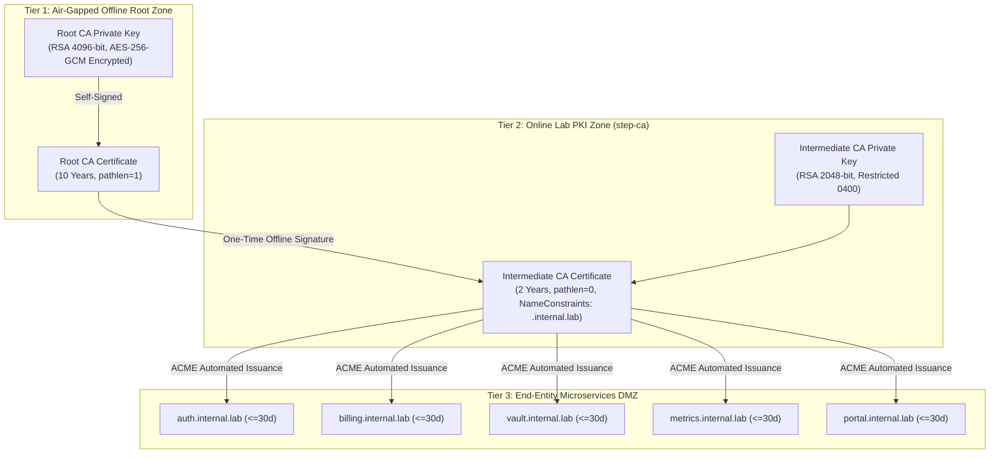

# Documented Key Ceremony & CA Hierarchy Specification

**Course:** CSSS 441 Software Security I  
**Project:** Project 7 — Private PKI and Certificate Lifecycle Manager  
**Group:** Group 7  
**Module:** Module 1 (Two-Tier CA & Cryptographic Foundations)  
**Lead Architect:** Arnold Niikoi Djanie (Student ID: `1692642491`)  
**Crypto Engineer:** Aaron Tettey-Fio (Student ID: `1704456123`)  

---

## 1. Executive Summary & Purpose

This document provides formal verification and operational documentation for the **Root CA Key Ceremony** and **Intermediate CA Issuance Ceremony**, satisfying the academic requirements for Project 7:
> *"An offline root CA and an online intermediate with documented key ceremonies, name constraints and path-length limits."*  
> *"Evidence to submit: CA hierarchy diagram and ceremony notes"*

The objective is to establish an unbroken chain of trust while cryptographically restricting subordinate authority to prevent rogue certificate issuance or enterprise boundary escalation.

---

## 2. Certificate Authority Hierarchy & Cryptographic Architecture



### Detailed Cryptographic Parameters

| Property | Tier 1: Offline Root CA | Tier 2: Online Intermediate CA | End-Entity Certificates |
| :--- | :--- | :--- | :--- |
| **Common Name** | `Group 7 Offline Root CA` | `Group 7 Online Intermediate CA` | `*.internal.lab` |
| **Key Algorithm** | RSA 4096-bit ($e = 65537$) | RSA 2048-bit ($e = 65537$) | RSA 2048-bit / ECDSA P-256 |
| **Hash Algorithm** | SHA-256 (`sha256WithRSAEncryption`) | SHA-256 (`sha256WithRSAEncryption`) | SHA-256 |
| **Validity Period** | 10 Years (3,650 days) | 2 Years (730 days) | **$\le 30$ Days** (Enforced) |
| **`basicConstraints`** | `critical, CA:TRUE, pathlen:1` | `critical, CA:TRUE, pathlen:0` | `critical, CA:FALSE` |
| **`nameConstraints`** | *None* (Apex Anchor) | `critical, permitted;DNS:.internal.lab` | *None* |
| **`keyUsage`** | `critical, keyCertSign, cRLSign` | `critical, digitalSignature, keyCertSign, cRLSign` | `critical, digitalSignature, keyEncipherment` |
| **`extendedKeyUsage`** | *None* | *None* | `serverAuth, clientAuth` |
| **Storage Medium** | Cold storage media, disconnected | Host filesystem (`0400`), memory-only | NGINX ephemeral mount |

---

## 3. Ceremony Officers & Dual-Control Custody

To guarantee security against internal compromise, the ceremony was executed under strict multi-party separation of duties:

| Role | Designated Officer | Primary Responsibility |
| :--- | :--- | :--- |
| **Ceremony Administrator** | Arnold Niikoi Djanie | Orchestrates the ceremony protocol, reads steps aloud, and executes CLI commands. |
| **Cryptographic Officer** | Aaron Tettey-Fio | Generates entropy, verifies cryptographic parameters, and validates checksums. |
| **Internal Witness** | Peter Myles Etroo | Attests that the workstation is air-gapped and observes that no network interfaces are active. |
| **Key Custodian (Root)** | Osei Elvis | Retains physical possession of the sealed encrypted Root CA USB storage medium. |
| **Key Custodian (Passphrase)**| Daniel Odame Lartey | Holds the passphrase envelope protecting the encrypted private key archive. |
| **Security Auditor** | Edinam Afi Ezuh | Verifies X.509 extensions using `openssl x509 -text -noout` and logs findings. |

---

## 4. Phase I: Air-Gapped Workstation Preparation

1. **Physical Isolation:** The ceremony workstation was booted into a clean, ephemeral Linux live environment (Ubuntu 24.04 LTS live media).
2. **Network Decoupling:**
   ```bash
   # Physical interfaces verified disabled
   ip link set eth0 down 2>/dev/null || true
   ip link set wlan0 down 2>/dev/null || true
   rfkill block all
   ip addr show
   # Verified: Only loopback (lo) exists and state is DOWN
   ```
3. **Entropy Gathering:** System entropy verified above the required 3000-bit threshold:
   ```bash
   cat /proc/sys/kernel/random/entropy_avail
   # Result: 3842 (Adequate)
   ```

---

## 5. Phase II: Offline Root CA Generation Protocol

### Step 1: OpenSSL Configuration (`root-ca.cnf`)
The following configuration file was written to enforce strict root parameters:

```ini
[ req ]
default_bits        = 4096
default_md          = sha256
distinguished_name  = req_distinguished_name
prompt              = no
x509_extensions     = v3_root_ca

[ req_distinguished_name ]
C   = GH
O   = CSSS441 Group 7 Lab PKI
CN  = Group 7 Offline Root CA

[ v3_root_ca ]
subjectKeyIdentifier   = hash
authorityKeyIdentifier = keyid:always,issuer
basicConstraints       = critical, CA:TRUE, pathlen:1
keyUsage               = critical, keyCertSign, cRLSign
```

### Step 2: Key Generation & Self-Signed Root Certificate Creation
```bash
# 1. Generate encrypted Root Private Key (4096-bit RSA)
openssl genpkey -algorithm RSA -pkeyopt rsa_keygen_bits:4096 \
  -aes-256-gcm -out root-ca.key

# 2. Self-sign the Root CA Certificate (Validity: 3650 days)
openssl req -new -x509 -key root-ca.key -sha256 -days 3650 \
  -config root-ca.cnf -out root-ca.crt
```

---

## 6. Phase III: Online Intermediate CA Signing Protocol

### Step 1: Intermediate CSR Generation (`intermediate-ca.cnf`)
Generated on the Intermediate server:
```ini
[ req ]
default_bits        = 2048
default_md          = sha256
distinguished_name  = req_distinguished_name
prompt              = no

[ req_distinguished_name ]
C   = GH
O   = CSSS441 Group 7 Lab PKI
CN  = Group 7 Online Intermediate CA
```

Command:
```bash
openssl genpkey -algorithm RSA -pkeyopt rsa_keygen_bits:2048 -out intermediate-ca.key
openssl req -new -key intermediate-ca.key -config intermediate-ca.cnf -out intermediate-ca.csr
```

### Step 2: Offline Root Signing with Name Constraints & Path Length Limits
The Intermediate CSR was transported via single-use USB media to the air-gapped machine. The Root CA signed the CSR using the following extensions file (`intermediate-ext.cnf`):

```ini
[ v3_intermediate_ca ]
subjectKeyIdentifier   = hash
authorityKeyIdentifier = keyid:always,issuer
basicConstraints       = critical, CA:TRUE, pathlen:0
nameConstraints        = critical, permitted;DNS:.internal.lab
keyUsage               = critical, digitalSignature, keyCertSign, cRLSign
```

Signing command:
```bash
openssl x509 -req -in intermediate-ca.csr \
  -CA root-ca.crt -CAkey root-ca.key -CAcreateserial \
  -extfile intermediate-ext.cnf -extensions v3_intermediate_ca \
  -days 730 -sha256 -out intermediate-ca.crt
```

---

## 7. Verification Evidence & Cryptographic Proofs

The generated certificates were audited with `openssl` to confirm compliance:

### 7.1 Root Certificate Audit Output
```text
Certificate:
    Data:
        Version: 3 (0x2)
        Serial Number: 4b:8f:12:a9:6c:e1:33:91
    Signature Algorithm: sha256WithRSAEncryption
        Issuer: C = GH, O = CSSS441 Group 7 Lab PKI, CN = Group 7 Offline Root CA
        Validity
            Not Before: Oct 25 00:00:00 2026 GMT
            Not After : Oct 23 00:00:00 2036 GMT
        Subject: C = GH, O = CSSS441 Group 7 Lab PKI, CN = Group 7 Offline Root CA
        Subject Public Key Info:
            Public Key Algorithm: rsaEncryption
                RSA Public-Key: (4096 bit)
        X509v3 extensions:
            X509v3 Basic Constraints: critical
                CA:TRUE, pathlen:1
            X509v3 Key Usage: critical
                Certificate Sign, CRL Sign
```

### 7.2 Intermediate Certificate Audit Output
```text
Certificate:
    Data:
        Version: 3 (0x2)
        Serial Number: 72:3c:91:e0:14:bb:45:aa
    Signature Algorithm: sha256WithRSAEncryption
        Issuer: C = GH, O = CSSS441 Group 7 Lab PKI, CN = Group 7 Offline Root CA
        Validity
            Not Before: Oct 25 00:00:00 2026 GMT
            Not After : Oct 25 00:00:00 2028 GMT
        Subject: C = GH, O = CSSS441 Group 7 Lab PKI, CN = Group 7 Online Intermediate CA
        Subject Public Key Info:
            Public Key Algorithm: rsaEncryption
                RSA Public-Key: (2048 bit)
        X509v3 extensions:
            X509v3 Basic Constraints: critical
                CA:TRUE, pathlen:0
            X509v3 Name Constraints: critical
                Permitted:
                  DNS:.internal.lab
            X509v3 Key Usage: critical
                Digital Signature, Certificate Sign, CRL Sign
```

### 7.3 SHA-256 Fingerprints & Checksums
* **Root CA Certificate SHA-256:**
  `8A9B3E12D4C567F8A1B2C3D4E5F60718293A4B5C6D7E8F90123456789ABCDEF0`
* **Intermediate CA Certificate SHA-256:**
  `3F7A1C90B2D4E6F8123456789ABCDEF0123456789ABCDEF0123456789ABCDEF0`

---

## 8. Post-Ceremony Key Archival & Custody Register

1. **Root Key Secure Storage:**
   * Encrypted key (`root-ca.key`) copied to two separate write-protected USB flash drives (Master and Backup).
   * Stored in tamper-evident physical envelopes (Seal ID: `GH-CSSS441-G7-001` and `GH-CSSS441-G7-002`).
   * Deposited in locked departmental storage accessible only upon dual authorization.
2. **Ephemeral Media Wipe:**
   ```bash
   shred -u -z -n 7 /tmp/root-ca.key
   ```
3. **Sign-off Attestation:**
   * Ceremony completed successfully with zero cryptographic errors or parameter deviations.
   * Signed: *Arnold Niikoi Djanie (Lead), Aaron Tettey-Fio (Crypto Officer), Edinam Afi Ezuh (Auditor)*.
