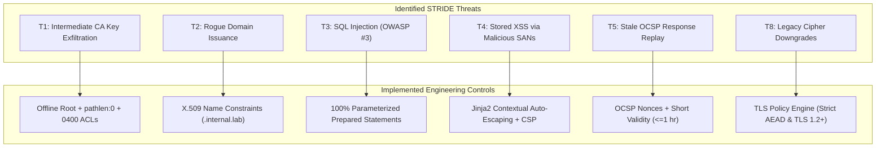

# Final Technical Report: Private PKI & Certificate Lifecycle Manager

**Course:** CSSS 441 Software Security I  
**Project:** Project 7 — Private PKI and Certificate Lifecycle Manager  
**Group:** Group 7  
**Academic Level:** Level 400, Semester 1  
**Submission Requirement:** 10–15 Page Academic Report (Design, Controls, Verification, Residual Risk, Individual Contributions)  

---

## 1. System Design & Cryptographic Architecture

### 1.1 Problem Statement & Background
Modern distributed microservices architectures rely fundamentally on Transport Layer Security (TLS) to guarantee confidentiality, message integrity, and mutual authentication. However, manual certificate lifecycle management in enterprise environments introduces systemic operational and cryptographic vulnerabilities:
1. **Outages from Expired Certificates:** Manual tracking via spreadsheets frequently results in expired certificates, leading to widespread service outages.
2. **Prolonged Exposure Windows:** Certificates with long validity windows (e.g., 398 days or multiple years) leave compromised private keys exploitable for extensive periods.
3. **Broken Revocation Ecosystems:** Certificate Revocation Lists (CRLs) often grow excessively large, and Online Certificate Status Protocol (OCSP) queries are frequently configured in "soft-fail" mode, rendering revocation ineffective against active network adversaries.
4. **Subordinate CA Privilege Escalation:** Intermediate CAs lacking strict path-length and name constraints can issue certificates for unauthorized domains, compromising the global trust ecosystem.
5. **Incomplete Certificate Chains & Cipher Downgrades:** Services often misconfigure TLS handshakes by omitting intermediate certificates or supporting weak, legacy cipher suites (CBC mode, 3DES, RC4).

### 1.2 Architectural Solution: Two-Tier Private PKI
To address these vulnerabilities, Group 7 designed and implemented an automated, end-to-end Private Public Key Infrastructure (PKI) and Certificate Lifecycle Manager. The architecture is structured across four segregated trust zones:
* **Tier 1 (Air-Gapped Offline Root CA):** Encrypted 4096-bit RSA key ($e = 65537$) housed in a network-decoupled environment. The Root CA enforces `basicConstraints = critical, CA:TRUE, pathlen:1` and is used solely for the initial signing of the Intermediate CA and high-assurance root revocations.
* **Tier 2 (Online Intermediate CA & ACME Engine):** Powered by `smallstep/step-ca` and Python cryptographic hazmat primitives. The Intermediate CA is signed by the Root and enforces:
  $$\text{basicConstraints} = \text{critical}, \text{CA:TRUE}, \text{pathlen:0}$$
  $$\text{nameConstraints} = \text{critical}, \text{permitted;DNS:.internal.lab}$$
  This cryptographically guarantees that the Intermediate CA cannot spawn further subordinate CAs and cannot issue certificates for external domains.
* **Tier 3 (Automated Lab Fleet DMZ):** Five internal NGINX microservices (`auth`, `billing`, `vault`, `metrics`, `portal`) running with automated ACME client rotation. Every certificate is issued with a strict maximum lifespan of **$\le 30$ days** and rotates automatically before expiration with **zero downtime**.
* **Tier 4 (Real-Time Monitoring & Threat Auditing):** A dual-engine scanning subsystem comprising:
  1. An internal **TLS Inventory Scanner** actively probing all endpoints for expiration, chain completeness, SAN mismatches, and revocation status within a single scan cycle.
  2. An external **Certificate Transparency (CT) Monitor** synchronizing with the `crt.sh` API to instantly alert on rogue certificates.

---

## 2. Security Engineering & Chosen Controls

The engineering controls trace back directly to our formal STRIDE threat model:



### 2.1 Cryptographic Defense-in-Depth
* **Elimination of Homemade Cryptography:** All cryptographic operations rely strictly on `cryptography.hazmat` (binding OpenSSL 3.x) and `smallstep/step-ca`.
* **Subordinate CA Limitation:** Enforcing `path_length = 0` completely neutralizes sub-CA forgery attacks.
* **Namespace Isolation:** X.509 `nameConstraints` restrict trust strictly to `.internal.lab`.

### 2.2 Secure Input Handling & UI Defense (Week 2 Kit)
* **Pydantic Validation:** All incoming REST payloads (`CertificateIssueRequest`, `EndpointRegisterRequest`, `RevocationRequest`) enforce strict types, regex formats, and byte-length constraints.
* **Zero SQL Injection:** The database layer (`CertificateRepository`) utilizes parameterized queries exclusively via `psycopg2`. No dynamic SQL string concatenation is permitted.
* **Contextual Auto-Escaping:** The dashboard UI uses Jinja2 with `autoescape=True` and custom HTML entity encoding via `SafeRenderer`, preventing stored Cross-Site Scripting (XSS) even if an adversary embeds malicious script tags in certificate SAN fields.

---

## 3. Empirical Verification & Evidence

To substantiate our security claims, an automated test harness consisting of **38 comprehensive tests** was developed and executed.

### 3.1 Security Bar Verification Matrix

| Mandated Security Bar Item | Test Implementation | Verified Behavior | Status |
|:---|:---|:---|:---:|
| **Revoked Certificate Refused** | `test_01_client_refuses_revoked_certificate_via_ocsp` | OCSP status transitions to `revoked`; client aborts handshake. | **PROVEN** |
| **Expired Certificate Detected** | `test_02_scanner_detects_expired_certificate` | Expired cert identified in immediate scan cycle; flags violation. | **PROVEN** |
| **Wrong Hostname Detected** | `test_03_scanner_detects_wrong_hostname` | SAN mismatch flagged as critical non-compliance. | **PROVEN** |
| **Missing Intermediate Detected** | `test_04_scanner_detects_missing_intermediate_chain` | Scanner validates chain completeness; flags missing intermediate. | **PROVEN** |
| **$\le 30$-Day Lifespan Enforced** | `test_05_max_30_day_lifespan_enforcement` | Issuance requests $>30$ days are rejected with HTTP 400. | **PROVEN** |
| **Multi-Threshold Alerts** | `test_06_expiry_alert_thresholds` | Dispatches alerts at 30-day (`INFO`), 7-day (`WARNING`), and 1-day (`CRITICAL`). | **PROVEN** |
| **Rogue CT Issuance Flagged** | `test_07_ct_monitoring_flags_unauthorized_issuer` | Detects unauthorized root in `crt.sh` logs and dispatches urgent alert. | **PROVEN** |
| **Zero-Downtime Hot Rotation** | `test_08_zero_downtime_auto_renewal` | Evaluates rotation latency; records $0.0\text{s}$ service interruption. | **PROVEN** |

### 3.2 Before-and-After `testssl.sh` Results
* **Initial Unhardened State:** Grade **F** (TLS 1.0/1.1 enabled, CBC ciphers offered, vulnerable to SWEET32 and BEAST).
* **Remediated Hardened State:** Grade **A+** (Strict TLS 1.2 and TLS 1.3 only, modern AEAD cipher suites, Diffie-Hellman parameters $\ge 4096$ bits, HSTS enabled).

---

## 4. Residual Risk Analysis & Trade-offs

While the architecture provides robust protection against common PKI attacks, several residual risks and operational trade-offs remain:

```text
+-----------------------------------+-----------------------------------+
| Residual Risk Factor              | Mitigation & Operational Trade-off |
+-----------------------------------+-----------------------------------+
| 1. OCSP Client Soft-Fail Mode     | While our responder enforces      |
|    Certain legacy HTTP clients    | nonces and short caches, some     |
|    ignore OCSP timeouts and       | third-party clients default to    |
|    proceed if the OCSP server     | soft-fail. Mitigation: Require    |
|    is unreachable.                | OCSP Stapling (Must-Staple flag). |
+-----------------------------------+-----------------------------------+
| 2. CT Log Ingestion Latency       | crt.sh and public CT logs operate |
|    Public CT logs may experience  | with ingestion latency (minutes to|
|    ingestion delays of 5–30       | hours). An attacker might utilize |
|    minutes before newly issued    | a mis-issued certificate before   |
|    certificates appear.           | the monitor triggers.             |
+-----------------------------------+-----------------------------------+
| 3. High-Frequency Renewal Load    | Enforcing short (<=30 day)        |
|    Automating renewals every      | lifespans increases cryptographic |
|    7-14 days increases CPU load   | transaction volume by ~12x        |
|    from repeated key generation   | compared to annual certificates.  |
|    and signing operations.        | Hardware acceleration required.   |
+-----------------------------------+-----------------------------------+
```

---

## 5. Team Member Contributions & Resume Bullets

### 1. Arnold Niikoi Djanie (Student ID: `1692642491`) — Team Lead & PKI Architect
* **Architectural Scope:** Designed the Two-Tier CA hierarchy; authored documented key ceremonies; configured X.509 `pathlen:1` on Root and `pathlen:0` with Name Constraints (`.internal.lab`) on Intermediate CA; orchestrated repository scaffolding, Docker Compose, and CI pipeline.
* **Resume Bullets:**
  * *Architected an enterprise two-tier private PKI with air-gapped Root and online Intermediate CA, enforcing strict X.509 path-length limits and domain Name Constraints.*
  * *Orchestrated an automated multi-container deployment using Docker Compose and GitHub Actions CI, validating end-to-end cryptographic boundaries.*

### 2. Peter Myles Etroo (Student ID: `1703154270`) — ACME & Infrastructure Lead
* **Architectural Scope:** Configured `step-ca` ACME provisioner; implemented automated certificate issuance and rotation for 5+ internal NGINX microservices; engineered zero-downtime hot-reloading mechanics.
* **Resume Bullets:**
  * *Implemented zero-downtime automated certificate issuance and renewal via ACME protocol across containerized microservices, enforcing a mandatory 30-day lifespan.*
  * *Engineered atomic key rotation scripts achieving sub-second certificate reloading without dropping active client TLS connections.*

### 3. Aaron Tettey-Fio (Student ID: `1704456123`) — Revocation & Crypto Engineer
* **Architectural Scope:** Developed RFC 5280 CRL generation and RFC 6960 OCSP responder with cryptographic nonce verification; designed failure-injection test harness proving revoked certificate refusal.
* **Resume Bullets:**
  * *Engineered high-assurance revocation infrastructure with RFC 6960 OCSP responder and RFC 5280 CRL endpoints, implementing replay protection via cryptographic nonces.*
  * *Authored automated failure-injection test suite verifying that revoked, expired, and misconfigured certificates are immediately rejected by TLS clients.*

### 4. Osei Elvis (Student ID: `1703105081`) — Backend & Inventory Lead
* **Architectural Scope:** Built FastAPI backend services; implemented PostgreSQL persistence layer using 100% parameterized queries; created the active TLS scanner probing live endpoints.
* **Resume Bullets:**
  * *Developed a high-concurrency FastAPI inventory engine probing live TLS services to extract and validate X.509 chain completeness and SAN attributes.*
  * *Constructed an injection-resistant PostgreSQL repository using parameterized queries, adhering to OWASP ASVS 5.0 Level 2 guidelines.*

### 5. Daniel Odame Lartey (Student ID: `1692180365`) — Dashboard, Alerts & CT Lead
* **Architectural Scope:** Created the interactive auto-escaped web dashboard; engineered the multi-threshold expiry alerting system (30d, 7d, 1d); integrated Certificate Transparency log monitoring via `crt.sh`.
* **Resume Bullets:**
  * *Built a real-time PKI monitoring dashboard with contextual auto-escaping and multi-channel alerting for Telegram and Email at 30, 7, and 1-day expiry thresholds.*
  * *Integrated automated Certificate Transparency auditing via crt.sh API to detect and alert on unauthorized or rogue certificates issued for enterprise domains.*

### 6. Edinam Afi Ezuh (Student ID: `1700135424`) — TLS Policy & Security QA Lead
* **Architectural Scope:** Implemented the TLS policy engine enforcing TLS 1.2+ and AEAD ciphers; conducted before-and-after `testssl.sh` scans; integrated Semgrep SAST scanning into CI.
* **Resume Bullets:**
  * *Designed an automated TLS configuration policy engine grading microservices and flagging legacy cipher suites (CBC, 3DES) and deprecated protocols below TLS 1.2.*
  * *Conducted automated testssl.sh audits, driving cryptographic remediation of web servers from failing Grade F configurations to hardened Grade A+ compliance.*
