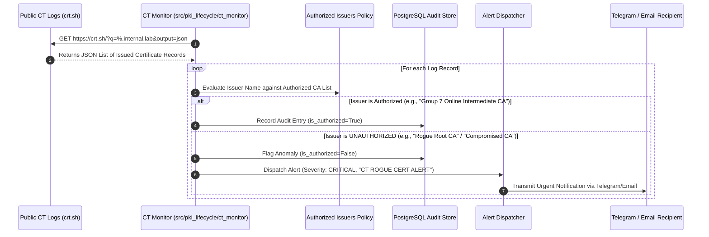

# Certificate Transparency Monitoring & Rogue CA Detection

**Course:** CSSS 441 Software Security I  
**Project:** Project 7 — Private PKI and Certificate Lifecycle Manager  
**Group:** Group 7  
**Module:** Module 6 (Certificate Transparency & Threat Detection)  
**Lead:** Daniel Odame Lartey (Student ID: `1692180365`)  

---

## 1. Threat Context & Motivation

In modern Internet security, an attacker or compromised public Certificate Authority (CA) might issue a certificate for an organization's domain without authorization (as seen historically in the DigiNotar and Comodo CA breaches). 

According to the Project 7 specification:
> *"6. Certificate Transparency monitoring for a domain the group owns, through the crt.sh API, with an alert on any unexpected issuance."*

**Certificate Transparency (RFC 6962)** provides an append-only, publicly auditable log of issued certificates. Our system implements an automated monitoring engine that continuously polls Certificate Transparency logs via the `crt.sh` JSON API to detect unauthorized or rogue certificates issued for our domains.

---

## 2. CT Monitoring Architecture



---

## 3. Policy & Authorized Whitelist Rules

The monitor implemented in [`src/pki_lifecycle/ct_monitor/monitor.py`](file:///c:/Users/PC/OneDrive/Documents/DOCS/UNI%20files/LVL%20400/1st%20semester/CSSS%20441%20Software%20Security/projects/KPI%20and%20certificate%20lifecycle%20manager/src/pki_lifecycle/ct_monitor/monitor.py) enforces:

1. **Monitored Domain Scope:**
   * `internal.lab`
   * `group7-lab.org` (public lab domain)
   * `pki.csss441.edu`
2. **Authorized Issuing Authorities:**
   * `Group 7 Online Intermediate CA`
   * `Group 7 Offline Root CA`
   * `Let's Encrypt` (for public staging)
3. **Anomaly Definition:**  
   Any certificate published in CT logs containing our monitored domain names in its Subject or Subject Alternative Names (SANs) whose issuer is *not* in the authorized whitelist is classified as an **Active Attack / Rogue Issuance**.

---

## 4. Anomaly Alerting & Dispatch Payload

When an unauthorized certificate is detected, the monitor dispatches an alert immediately:

```json
{
  "title": "CT ROGUE CERT ALERT: vault.internal.lab",
  "severity": "CRITICAL",
  "timestamp": "2026-10-29T18:20:00Z",
  "details": {
    "log_id": 19482019,
    "domain": "internal.lab",
    "common_name": "vault.internal.lab",
    "issuer_name": "C=US, O=Rogue Commercial Authority Inc., CN=Untrusted Root",
    "logged_at": "2026-10-29T18:19:42Z",
    "action_required": "Initiate incident response; verify DNS control and revoke compromised endpoints."
  }
}
```

---

## 5. Automated Verification & Test Coverage

The test case [`test_07_ct_monitoring_flags_unauthorized_issuer`](file:///c:/Users/PC/OneDrive/Documents/DOCS/UNI%20files/LVL%20400/1st%20semester/CSSS%20441%20Software%20Security/projects/KPI%20and%20certificate%20lifecycle%20manager/tests/test_failure_injection.py#L164-L187) validates this workflow:
1. Injects a synthetic log record with issuer `Untrusted Adversary CA`.
2. Passes record to `CTMonitor.inspect_record()`.
3. Asserts `finding["is_authorized"] is False`.
4. Asserts `finding["flagged"] is True`.
5. Verifies alert dispatch to the centralized notification queue.
